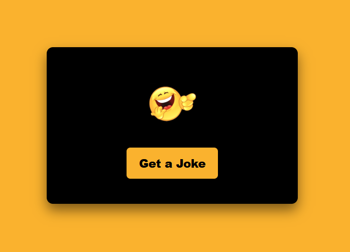
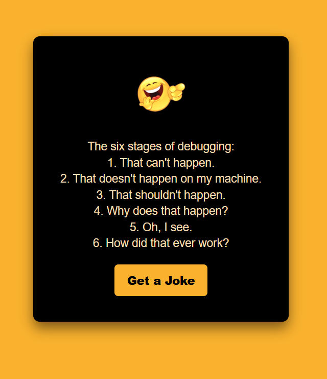

# 😂 Jokes Generator App

A simple and interactive web application built using HTML, CSS, and JavaScript that fetches jokes from an external API. Users can generate new jokes with a single click for an instant dose of entertainment.

## ✨ Features

* 😂 **Instant Jokes:** Fetch jokes dynamically from an external API.
* 🔄 **Generate New Jokes:** Get another joke with a button click.
* ⚡ **API Integration:** Retrieve data asynchronously using JavaScript.
* 📱 **Responsive Design:** Enjoy a smooth experience across different screen sizes.
* 🎯 **Simple Interface:** Clean and easy-to-use layout.

## 🛠️ Tech Stack

* **HTML5** – Application structure
* **CSS3** – Styling and responsive design
* **JavaScript** – Application logic and DOM manipulation
* **Jokes API** – Fetches jokes dynamically
* **Tools:** VS Code, Git, and GitHub

## 📸 Screenshots

### Initial Interface

The application's interface before generating a joke.

  

### Generated Joke

The application displaying a joke after clicking the generate button.

  

## 💡 Key Learnings

* Integrated an external API to fetch dynamic content.
* Practiced asynchronous JavaScript using `fetch()`.
* Improved DOM manipulation and event handling skills.
* Implemented button-driven interactions.
* Strengthened frontend development fundamentals.

## 👨‍💻 Author

**Siddharth Singh**

* GitHub: [sidd-singh04](https://github.com/sidd-singh04)
* Live Project: [Jokes Generator App](https://jokes-app-gamma.vercel.app/)

